

# 💞 MT-29 Chat

**Eşin, ailen ve dostların için güvenlik odaklı iletişim ve "haber alma" uygulaması**

Sohbet · Çemberler · Sevgi dokunuşları · Kilit ekranına çizim · 🎨 Çiz-Bil · SOS · Herkes iyi mi?

> [!NOTE]
> **Bu depo bir vitrindir.** Uygulamanın ne yaptığını ve nasıl tasarlandığını tanıtır; **kaynak kodu içermez.**
> Uygulamanın **tam ve gelişmiş sürümü geliştiricide, özel olarak** durmaktadır.

---

## ✨ Hikâye

MT-29 Chat, **yaklaşık 7–10 aydır** üzerinde çalışılan, uzun bir emeğin ürünü. Amaç basit ama iddialıydı:
sevdiklerinle hem **sıcak ve eğlenceli** bir bağ kurmak, hem de bir şey olduğunda **saniyeler içinde haber alabilmek**
— ve bunu yaparken **verinin kimseye satılmadığı, kimseyle paylaşılmadığı** bir sistem kurmak.

Her özellik iki telefonla, emülatörde ve otomatik testlerle defalarca denendi; bulunan her hata düzeltilip
yeniden test edildi.

---

## 📱 Ekran görüntüleri

> Görüntülerdeki kişiler ve mesajlar **demo** amaçlıdır (gerçek kişi ya da veri yoktur).

| Çemberler | Çember | Sohbet |
|:---:|:---:|:---:|
| 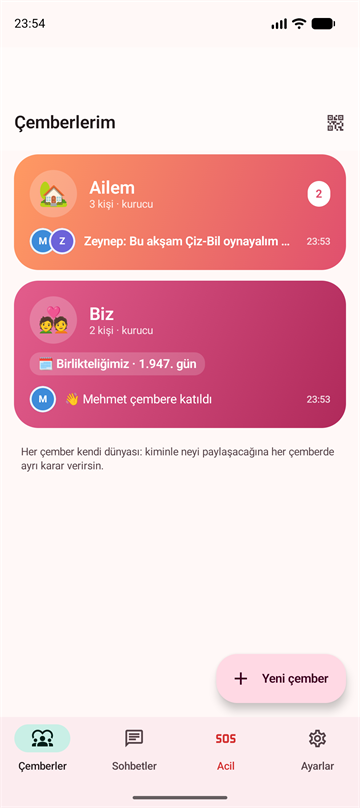 | 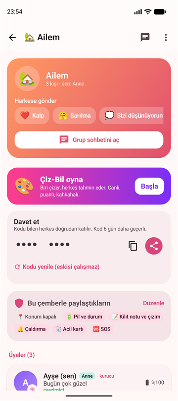 | 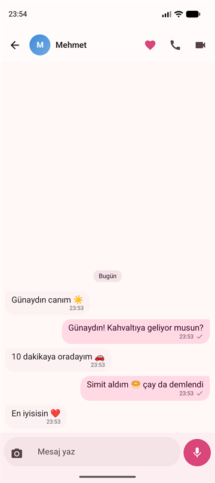 |
| **🎨 Çiz-Bil — lobi** | **Canlı çizim** (çizenin kalemi herkeste görünür) | **Doğru tahmin → konfeti** |
| 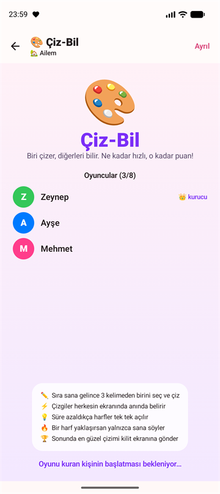 | 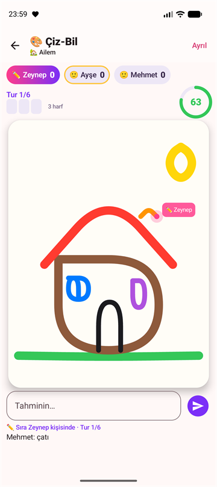 | 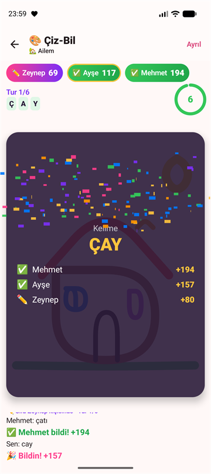 |
| **Kürsü + turların çizimleri** | **Kilit ekranına çizim** | **Kilit ekranında duruyor** |
| 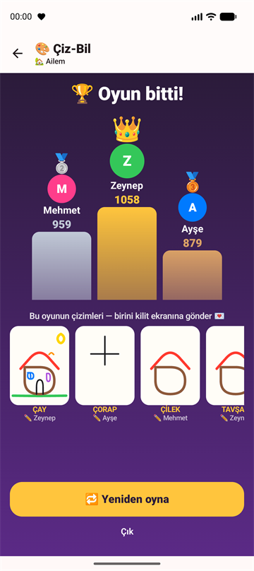 | 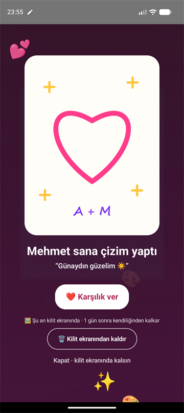 | 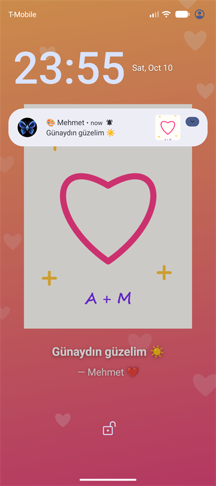 |
| **Sarılma, uygulama kapalıyken bile** | **Herkes iyi mi?** | **SOS alarmı** |
| 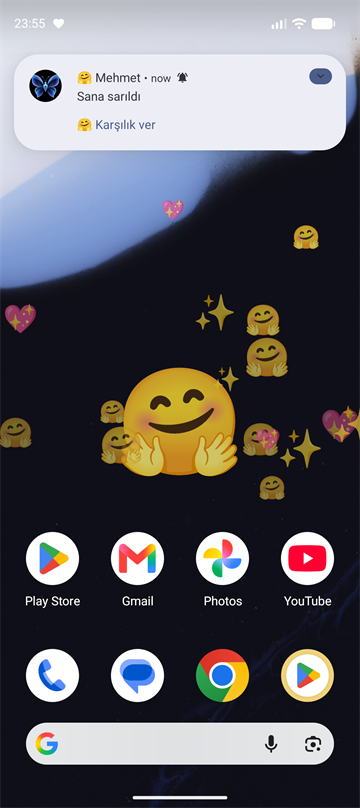 | 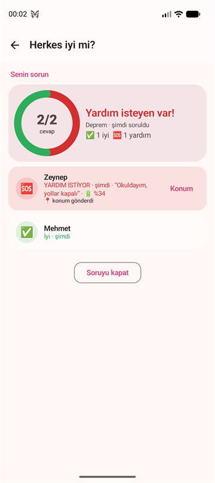 | 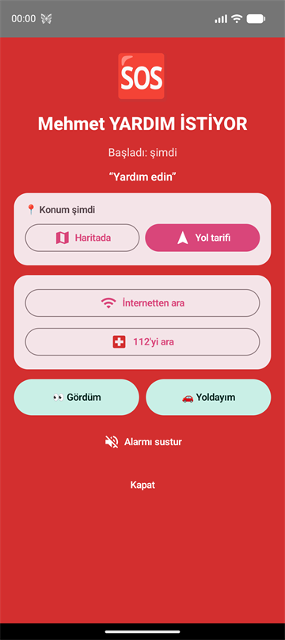 |

---

## 🧩 Özellikler

### 👥 Çemberler — kiminle neyi paylaşacağına sen karar verirsin
- **Eşim · Ailem · Dostlarım** ya da kendi çemberin; davet koduyla katılım, istenirse **kurucu onayı**.
- Konum, pil durumu, kilit ekranı notu, çaldırma, acil kartı ve SOS **her çemberde ayrı ayrı** açılıp kapatılır.
- Özel gün sayacı ("Birlikteliğimiz · 1.947. gün").

### 💬 Sohbet ve arama
- Birebir ve grup sohbeti, fotoğraf, **sesli mesaj** (1.5x / 2x), "yazıyor…", çevrimiçi / son görülme, okundu bilgisi.
- **Sesli ve görüntülü arama**: uygulama kapalıyken bile çalar, kilit ekranında tam ekran açılır, görüşme kaydedilmez.

### ❤️ Sevgi dokunuşları ve kilit ekranı
- Kalp, sarılma, öpücük, iltifat — karşı taraf **uygulamayı açmasa bile görür**: telefon kilitliyse ekran açılır,
  ana ekrandaysa kalpler ekranın üstünde uçuşur; her dokunuşun kendine özel titreşimi vardır.
- **Kilit ekranına yaz ya da çiz**: parmağınla çizdiğin kalp sevdiğinin kilit ekranında belirir.
  Alan kişi tek dokunuşla kaldırabilir ya da istediği süre (1 saat / 1 gün / 1 hafta) sonra kendiliğinden kalkar.

### 🎨 Çiz-Bil — aile ve çiftler için canlı oyun
- Biri çizer, herkes **kendi telefonundan** tahmin eder; çizgiler herkesin ekranında **anında** belirir.
- Çizenin kalemi isimli, parlayan bir imleçle görünür; süre azaldıkça harfler açılır, son saniyeler titreşir.
- Hızlı bilen çok puan alır, çizen de her bilen için puan kazanır; bir harf yaklaşana **"🔥 Çok yaklaştın!"** yalnızca ona söylenir.
- Oyun sonunda **kürsü** 👑🥈🥉 ve turların çizim galerisi — en güzel çizim tek dokunuşla birinin kilit ekranına.
- Kelime yalnızca sunucuda tutulur, çizmeyenlerin telefonuna **hiç gönderilmez** (hile yapılamaz).

### 🆘 Acil durum ve "haber alma"
- **SOS**: 5 saniye geri sayım → yakınlarda tam ekran alarm + canlı konum; internet yoksa acil kişilere SMS.
- **Gizli SOS**: ses kısma tuşuna 5 kez bas — siren yok, ekranda iz yok, yardım sessizce gider.
- **Herkes iyi mi?**: deprem / yangın anında tek dokunuşla herkese sor; cevaplar canlı panoda, yardım isteyenin konumuyla.
- **Güvenli yol**: zamanında varmazsan yakınların son konumunla uyarılır.
- **Düşme algılama**: sert düşüş + hareketsizlik → "Düştün mü?" → cevap yoksa konumlu SOS (algılama tamamen telefonda).
- **Son nefes**: şarj biterken ya da telefon kapanırken son konum bir kez gider; açılınca "ne kadar kapalıydı" bildirimi.
- **Acil durum kartı**: kan grubu, alerjiler, ilaçlar — yalnızca seçtiğin çemberlerle.

### 🛡️ Hırsıza ve zorlamaya karşı
- **Uygulama kilidi** (parmak izi / yüz / kendi PIN'i).
- **Tehlike PIN'i**: biri zorla açtırırsa bu PIN girilir → uygulama normal açılır, yakınlara **sessizce** SOS gider.
- **Kayıp telefon modu**: başka cihazdan "kayboldu" → telefon sessizde bile çalar, kilit ekranında "bulursanız arayın" yazar,
  konumu sahibine gelir; gerekirse **uzaktan silme**.
- **Yeni girişlere onay**: şifren ele geçse bile, kayıtlı telefonundan onay vermeden yeni bir cihazdan giriş yapılamaz.

---

## 🔒 Güvenlik ve gizlilik

Bu uygulama, **önce güvenlik** düşünülerek tasarlandı:

- 🚫 **Veriler üçüncü taraflara verilmez, satılmaz.** Uygulamada **reklam, analiz ya da izleme kütüphanesi yoktur.**
- 🏠 **Sunucu kendi kontrolünde** çalışır (self-hosted); veriler bir bulut şirketinin veri havuzunda değil.
- 🔐 Mesajlar, notlar, fotoğraflar, sesli mesajlar ve acil kartı **sunucuda şifreli** (AES-256-GCM) saklanır.
- 📨 Bildirimler Google üzerinden **uçtan uca şifreli** iletilir — Google yalnızca şifreli veri taşır, içeriği göremez.
- 📞 Aramalar cihazlar arasında şifreli akar ve **kaydedilmez**.
- 👁️ **Gizlilik geçmişi**: konumunu kim istedi, telefonunu kim çaldırdı, kartını kim açtı — hepsini görürsün.
- 🔑 Oturum yönetimi: hangi cihazların hesabına bağlı olduğunu görür, tanımadığını anında kapatırsın.
- ✅ Her güncelleme öncesi **281 otomatik güvenlik kontrolü** çalıştırılır (yetkisiz erişim, başkasının verisine ulaşma,
  sahte istek, oturum çalma, hız sınırları, şifreleme…).

> Bildirim iletimi için Google'ın bildirim altyapısı (FCM) ve telefonun kendi konum servisi kullanılır;
> bunun dışında hiçbir dış servise veri gönderilmez.

---

## 🏗️ Mimari (genel bakış)

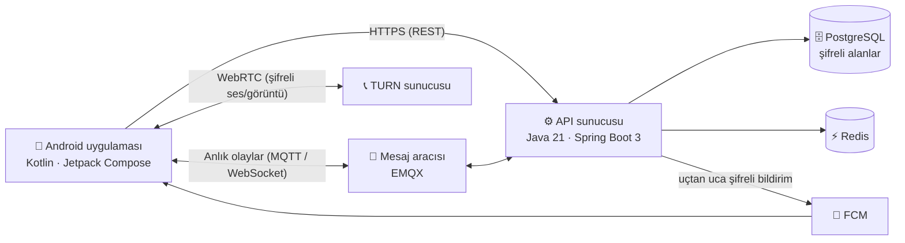

| Katman | Teknolojiler |
|---|---|
| **Android** | Kotlin, Jetpack Compose, WorkManager, WebRTC, Android Keystore |
| **Sunucu** | Java 21, Spring Boot 3, Spring Security, Flyway, PostgreSQL, Redis |
| **Gerçek zamanlı** | MQTT (EMQX), WebSocket (STOMP) |
| **Altyapı** | Docker Compose, Caddy (HTTPS), coturn (arama) |
| **Kalite** | Otomatik güvenlik test paketi, emülatörde uçtan uca testler |

---

## 🗺️ Durum

- ✅ Android uygulaması ve sunucu tamamlandı, iki telefonla gerçek kullanımda test ediliyor.
- 🔜 Play Store sürümü ve web paneli.

---

## 📄 Lisans

© 2026 — **Tüm hakları saklıdır.** Bu depo yalnızca tanıtım amaçlıdır; kaynak kod ve uygulamanın gelişmiş sürümü
paylaşılmamaktadır. Görsellerin izinsiz kullanımı yasaktır.

---

🇬🇧 English summary

**MT-29 Chat** is a security-first messaging and safety app for couples, families and close friends:
per-circle sharing (partner / family / friends), chat and calls, "love touches" that show up even when the app is closed,
drawings on the partner's lock screen, a live multiplayer drawing game (**Çiz-Bil**), SOS with live location,
"Is everyone OK?" check-ins, fall detection, last-gasp location, a duress PIN, lost-phone mode and login approval.

No ads, analytics or tracking libraries; data is never sold or shared. Messages are encrypted at rest, push notifications
are end-to-end encrypted, and 281 automated security checks are run before every update.
The product has been built over roughly 7–10 months.

**This repository is a showcase only — the source code and the full, advanced version are kept private by the author.**

